<p align="center">
  
</p>

# zmk-config-nickey44a

分割40%ワイヤレス自作キーボード **「Nickey44A」** のZMK Firmware設定リポジトリです。

## Nickey44Aについて

- 44キーのオーソリニア配列を採用した左右分割キーボード
- Bluetooth対応の完全ワイヤレス設計
- Choc v2スイッチ対応のロープロファイル設計
- 単4電池で動作
- ボトムからトッププレートまで6.5mmの薄型設計
- 電池、キースイッチキャップ込で222gの軽量仕上げ

BOOTHでは、キット版と完成品を取り扱っています。

- [Nickey44A キット版](https://potamega.booth.pm/items/8744351)
- [Nickey44A 完成品](https://potamega.booth.pm/items/8744204)

セットアップ、ファームウェアの書き込み、Bluetoothペアリングなどの詳しい手順は、[Nickey44A ビルドガイド](https://nixiy.github.io/nickey-docs/nickey44a/)を参照してください。

---

## 現在のキーマップ

[torabo-tsuki からのキー対応、接続先の切替、左右トラックパッドの操作](docs/dual-tps43.md)



## DYA Studio で実機の設定を変更する

torabo-tsuki 配列版は Zephyr 4.1.0 と DYA Studio 対応の ZMK を使用します。

1. 左右に対応する UF2 を書き込み、右手側をデータ通信対応の USB ケーブルで PC に接続します。
2. PC の Chrome または Edge で [DYA Studio](https://studio.dya.cormoran.works/) を開き、USB 接続で Nickey を選びます。
3. キーボードで Enter を長押しし、そのまま Backspace も長押しして Q を押すと、Studio の編集ロックが解除されます。USB 出力に切り替えるときは同じ設定レイヤーで R を押します。

キー割り当て、追加のコンボ・マクロ、接続先別の既定レイヤーを設定できます。トラックパッドは `lmouse`・`rmouse` が左右のカーソル、`lscroll`・`rscroll` が左右のスクロールです。それぞれ独立して感度を調整できます。

旧版からの更新では、接続先ごとの Windows / Mac 配列の保存先が変わります。各接続先で設定レイヤーの W（Windows）または E（Mac）を押すと、新しい保存先に記録されます。

---

## ⌨️ キーマップの変更方法 (Keymap Editor)

Web GUIツール **[Keymap Editor](https://nickcoutsos.github.io/keymap-editor/)** を使うと、コードを直接編集せずにブラウザ上でキーマップを変更できます。

1. 本リポジトリを自身のGitHubアカウントに Fork します。
2. [Keymap Editor](https://nickcoutsos.github.io/keymap-editor/)でForkしたリポジトリを選択し、キーマップを編集して保存します。
3. Commit / Push 後、GitHub Actions がファームウェアを自動ビルドします。

Forkの初回設定や詳しい編集手順は、[キーマップの変更方法](https://nixiy.github.io/nickey-docs/guides/keymap/)を参照してください。

> 💡 **コードを直接編集する場合:**  
> リポジトリ内の `config/nickey44a.keymap` を直接編集して Commit / Push することでも変更可能です。

---

## 🛠️ ファームウェアのビルドと書き込み方法 (Flashing)

### zmk-workspace でローカルビルド

このリポジトリと `zmk-workspace` を隣り合わせに置き、`zmk-workspace/config/zmk-config-nickey44a-pad` をこのリポジトリのルートへのシンボリックリンクにする。ワークスペースでの設定切替とビルドは次の手順で行う。

```sh
cd ../zmk-workspace
nix develop
just init config/zmk-config-nickey44a-pad  # 初回、または別のキーボードから切り替えるとき
just build 'nickey44a_[lr]$'
```

このコマンドは基準版の左右をビルドする。片側だけなら `just build 'nickey44a_l$'` または `just build 'nickey44a_r$'`。UF2はワークスペースの `firmware/zmk-config-nickey44a-pad/` に出力される。

既にこの Nickey を選択済みのワークスペースを旧版から移行する場合は、`nix develop` 内で次を実行する。設定リセット用とTPS43比較用を含む全 UF2 を新しい依存関係でビルドする。

```sh
just update
just build all -p
```

書き込みは片側ずつ行う。左手側だけを USB 接続してブートローダーモードにし、`just flash nickey44a_l` を実行する。左を外し、右手側で同じ操作をして `just flash nickey44a_r` を実行する。

[TPS43比較用ファームウェアの組み合わせと実機での試し方](docs/dual-tps43.md#tps43の比較用ファームウェア)

### GitHub Actions でビルド

Keymap Editorでの変更をCommit（または `main` ブランチへPush）すると、GitHub Actions がファームウェアを自動ビルドします。完了後、Actions の最新ワークフローから `firmware` をダウンロードしてください。

書き込みの詳しい手順は、[Firmwareの書き込み方法](https://nixiy.github.io/nickey-docs/guides/firmware/)を参照してください。左右のペアリングや設定リセットについては、[Nickey44A ビルドガイド](https://nixiy.github.io/nickey-docs/nickey44a/)を確認してください。

---

## 📄 ライセンス

This repository is licensed under the MIT License - see the [LICENSE](LICENSE) file for details.

### 第三者ライセンス

Nickey44A の昇圧回路は、cormoran 氏が [DYA Dash の回路設計解説](https://note.com/cormoran/n/n1e45fe7471d8) で紹介している、各種保護機能付き昇圧回路を参考にしています。DYA Dash の回路図（`*.kicad_sch`）は MIT License で提供されています。

- Copyright (c) 2025 cormoran
- ライセンス全文: [THIRD_PARTY_NOTICES.md](THIRD_PARTY_NOTICES.md)
